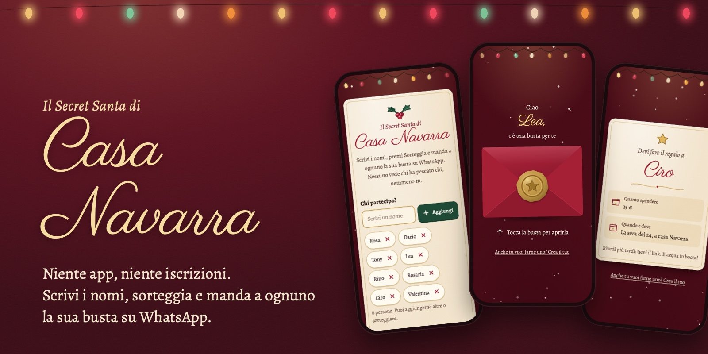
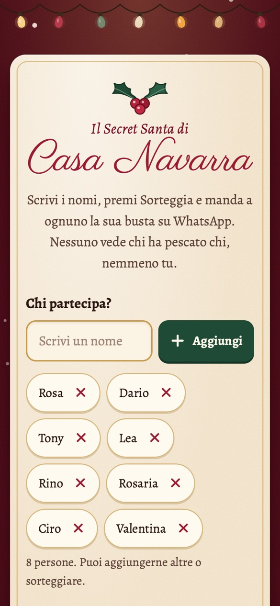
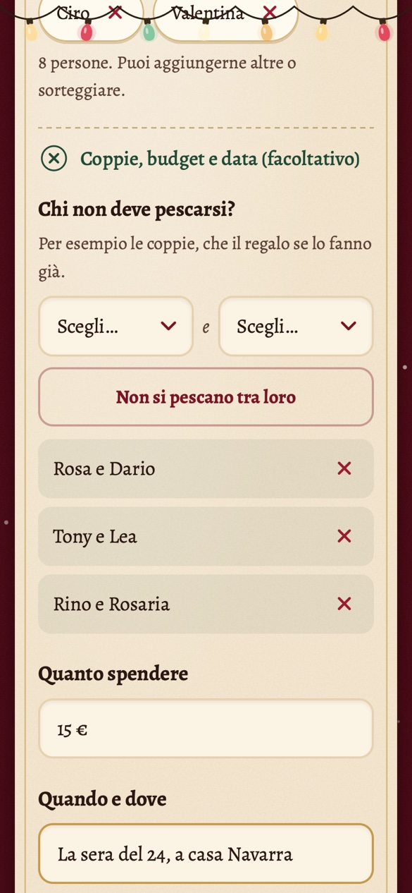
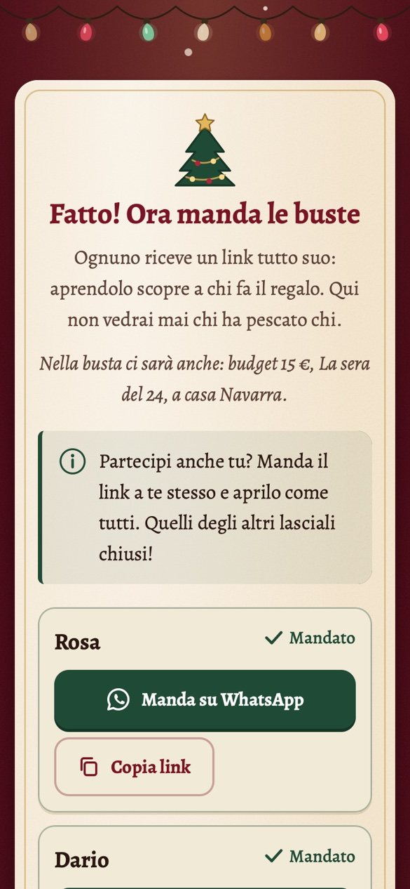
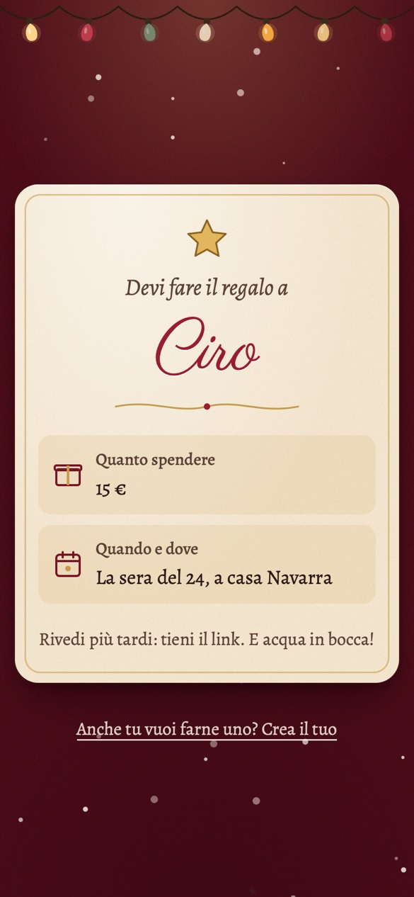
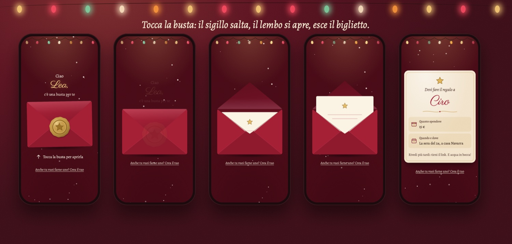

<p align="center"></p>

<p align="center">
  
  
  
  
  
</p>

<h1 align="center">Il Secret Santa di Casa Navarra</h1>

<p align="center"><b>A Secret Santa that anyone can use, even the least technical relative.</b><br>
One person writes the names, everybody else just opens a link on WhatsApp.</p>

<p align="center"><a href="https://antonionavarra.github.io/SecretSantaCasaNavarra/"><b>Open the live page</b></a></p>

## Table of contents

- [About the project](#about-the-project)
- [How it works](#how-it-works)
- [Features](#features)
- [Design](#design)
- [How the draw and the links work](#how-the-draw-and-the-links-work)
- [Privacy](#privacy)
- [Getting started](#getting-started)
- [Repository layout](#repository-layout)
- [Status](#status)
- [Author](#author)

## About the project

Every Christmas somebody says "let's do a Secret Santa", and then it stalls: nobody wants to install an app, create an account, or fight with a clumsy website. This page removes everything except the game.

Only the **organiser** does anything. They type the names, press *Sorteggia* (Draw), and send each person a personal link on WhatsApp. Everybody else just taps their link, taps the envelope, and finds out who they are giving a present to. No app, no account, no email, no password, and it works on any phone and on a computer.

It started as a family tool for the Navarra Christmas, and it is deliberately small: one HTML file, no framework, no backend. The interface is in Italian.

## How it works

<table>
<tr>
<td align="center" width="25%"><br><b>1. Write the names</b><br><sub>At least three. Duplicates are caught, even with different capitals or accents.</sub></td>
<td align="center" width="25%"><br><b>2. Optional extras</b><br><sub>Couples who must not draw each other, a budget, when and where.</sub></td>
<td align="center" width="25%"><br><b>3. Send the envelopes</b><br><sub>One WhatsApp button and one copy-link button per person. The organiser never sees who drew whom.</sub></td>
<td align="center" width="25%"><br><b>4. Open and discover</b><br><sub>Tap the envelope, the card slides out with the name, the budget and the date.</sub></td>
</tr>
</table>

<p align="center"></p>

## Features

- **Zero friction for everyone but the organiser:** no installation, no sign-up, no password. A link is all it takes.
- **A reveal worth opening:** a red envelope with a gold wax seal; the seal breaks, the flap opens in 3D, the card rises, confetti falls.
- **Couples and exclusions:** pick two people who must not draw each other; the draw respects it.
- **Optional budget, date and place** travel inside every envelope.
- **WhatsApp in one tap:** each person has a *Manda su WhatsApp* button with the message already written, plus a *Copia link* fallback. Rows turn to *Mandato* (sent) and a counter shows how many are left.
- **Hard cases are handled:** if the exclusions make the draw impossible, the page says so in plain words instead of looping forever.
- **Broken links fail kindly:** a damaged link shows a friendly message, not an error.
- **Refresh-safe:** the share screen survives a page reload.
- **Made to be read by everyone:** 19 px base text, buttons at least 56 px tall, visible focus, ARIA labels, and a reduced-motion mode (the envelope opens at once, no snow, no confetti).
- **Works from 320 px wide** with no horizontal scrolling.

## Design

A hand-made Christmas card: cranberry background, warm cream paper with a faint grain, antique gold, pine green. Every illustration (holly, tree, star, wax seal, envelope, string lights) is drawn by hand as inline SVG, with no emoji and no image files. Type is Alegreya for text and Parisienne for names, with system fallbacks (Palatino/Georgia and a system cursive) when offline.

The guiding rule is that the *reveal* is the only moment that deserves flourish; everything else is plain, large and calm.

## How the draw and the links work

**The draw.** Random shuffles that reject self-draws and excluded pairs, up to 4000 tries. If none works, an exhaustive search either finds a valid assignment or proves there is none, and the page tells the organiser to remove an exclusion. The result is always a single permutation: everybody gives exactly one present and receives exactly one.

**The links.** There is no server. Each personal link carries its own content after the `#`, and the browser never sends that part to anybody:

```
https://…/#<base64url( XOR( JSON{giver, receiver, budget, when}, per-draw random key ) + check byte )>
```

A corrupted or truncated link fails the check byte and shows the friendly error page.

**What was tested.** The draw and the link encoding were run in Node over 6,900 draws from 3 to 25 people, with and without excluded couples: nobody drew themselves, exclusions held, and impossible cases were detected. Links round-trip with emoji, accents, Cyrillic and Chinese, and damaged links are rejected. The full flow was also run in a WebKit browser with no script errors. The test scripts were throwaway and are not part of this repository.

## Privacy

- No server, no analytics, no cookies, no accounts. Names exist only in the browser of the organiser and inside the links they send.
- The organiser's screen **never shows** who drew whom.
- Honest limit: the links are **obfuscated, not encrypted**. Someone who reads this code and has the link can decode it. This is a game between family members, not a secret service, and the page is built so that nobody sees a result by accident. The same limit applies to the organiser: they could in theory decode the links they send, so a draw is fair as long as they play by the rules (or, as the page suggests, send their own link to themselves and open it like everybody else).
- Fonts are loaded from Google Fonts; without a connection the page falls back to system fonts.

## Getting started

It is a static page. Open `index.html` in a browser to try it locally, or host the folder anywhere that serves static files.

To share links that work on everybody's phone, the page must be served over a public `https://` address. This repository is published with **GitHub Pages**:

1. Settings → Pages → Source: *Deploy from a branch*, branch `main`, folder `/ (root)`.
2. After a minute the page is at `https://<user>.github.io/<repository>/`.

Alternatively, drag the folder onto [Netlify Drop](https://app.netlify.com/drop).

To use it for your own family, change the title in `index.html` (the `<title>`, the `og:title` meta tag and the `<h1>`), and the absolute `og:image` / `og:url` addresses to your own.

## Repository layout

```
SecretSantaCasaNavarra/
├── index.html      # the whole app: markup, CSS, JS, SVG illustrations
├── README.md
└── docs/
    ├── cover.jpg   # README cover
    ├── opening.jpg # the envelope opening, step by step
    ├── og.jpg      # preview image shown when a link is shared (1200×630)
    └── screens/    # screenshots used in this README
```

## Status

A finished small tool, built in a few days for Christmas 2026. Checked in a desktop WebKit browser. The real WhatsApp hand-off (opening WhatsApp, link preview in a chat, copy to clipboard and opening links inside WhatsApp's in-app browser) still needs a test on real phones. There is no licence file yet, so by default all rights are reserved.

## Author

Antonio Navarra, [@AntonioNavarra](https://github.com/AntonioNavarra).
